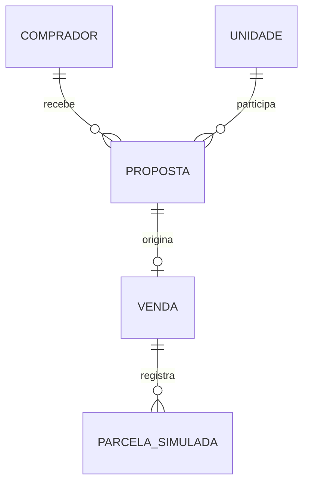

# Modelo conceitual de dados

**Estado:** modelo conceitual e esquema SQL parcialmente implementados. O
núcleo de E2 está versionado nas migrações Flyway V1 a V5; o modelo lógico e
as regras comerciais completas ainda precisam de aprovação antes da E3.

## Núcleo conceitual

Cada proposta tem exatamente um comprador e uma unidade. Um comprador e uma unidade podem participar de várias propostas ao longo do tempo. Uma proposta pode gerar uma venda. A unicidade de venda ativa por unidade é uma regra adicional de integridade, não demonstrada apenas pela cardinalidade.

## Entidades e relações propostas

| Entidade | Relação / conteúdo |
| --- | --- |
| ModeloVeiculo | Um modelo para várias unidades; marca, nome, motorização e categoria. |
| UnidadeVeiculo | Um modelo; chassi, preço, condição, estado e fotos. |
| Comprador | Cadastro e contato; pode existir sem conta de acesso. |
| ContaUsuario / Perfil | Permissões; vínculo com comprador quando aplicável. |
| Atendimento / Interacao | Comprador, oportunidade, responsável, autor, data e histórico. |
| Proposta / Versao | Comprador, unidade, valores preservados, validade e condições. |
| Simulacao / Aprovacao | Parâmetros, resultados e decisões com autoria. |
| Venda | Fechamento fictício, proposta e consistência com estoque. |
| ParcelaSimulada | Vencimento, valor e vínculo ao cronograma. |
| Configuracao / Auditoria | Identidade, políticas versionadas e ações relevantes. |

## Pontos do modelo lógico

- Definir chaves, campos obrigatórios, índices, unicidade e limites de tamanho.
- Definir como proposta, versão e cronograma de simulação serão persistidos. A ligação conceitual de parcelas à venda não impede simular parcelas antes dela.
- Usar `BigDecimal` no Java e tipos decimais no banco para dinheiro; fixar escala e arredondamento.
- Preservar preço e políticas aplicados na proposta. Alterar catálogo não reescreve histórico.
- Definir o conjunto de estados da unidade e da proposta antes de mapear transições.
- Garantir RN01, RN02 e RN03 também por integridade no banco, conforme o modelo aprovado.
- Definir concorrência e transação do fechamento; não confiar apenas em “consultar disponível” antes de gravar.

## Estado do esquema atual

O banco já possui tabelas para loja, usuários, compradores, veículos,
interesses, propostas, versões, vendas, parcelas simuladas e auditoria. E2 usa
efetivamente usuários, compradores, veículos e oportunidades para catálogo,
estoque, autenticação e área do comprador. Propostas, parcelas e vendas estão
preparadas no esquema, mas ainda não possuem casos de uso completos na API.

## Entregas de SV05

Diagrama editável, dicionário de dados, relacionamentos, regras de integridade e decisões de transação. Depois, SV09 versiona as migrações. Não inserir regras de reserva, cancelamento ou múltiplos itens sem revisão de escopo.
